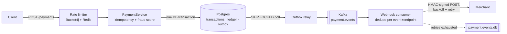

# Mini Payment Gateway

[](https://github.com/IronX10/Mini_Payment_Gateway/actions/workflows/ci.yml)

A payment gateway backend in Spring Boot that moves money the way real payment systems do: every transfer is an immutable **double-entry ledger** pair, every write is **idempotent**, concurrent transfers can't lose updates or overdraw, and every committed payment produces a **signed webhook** via a transactional outbox and Kafka, delivered at-least-once with retries. Redis provides distributed rate limiting and caching, and a rules-based fraud engine holds suspicious payments for review before any money moves. The correctness claims are proven by Testcontainers integration tests against real Postgres, Kafka and Redis.

**Stack:** Java 17 · Spring Boot 4 · PostgreSQL 16 · Kafka · Redis · Flyway · Bucket4j · Testcontainers · Docker

## Run locally in 2 commands

Requires Docker.

```bash
docker compose up -d --build
```

```bash
curl -s localhost:8080/actuator/health
```

That starts Postgres, Redis, Kafka and the app on `http://localhost:8080`. The first build takes a few minutes; later builds reuse cached layers.

### Make a payment

```bash
# Two accounts (note the returned ids - account 1 is the gateway's internal funding account)
curl -s -XPOST localhost:8080/api/v1/accounts -H 'Content-Type: application/json' -d '{"email":"alice@example.com"}'
curl -s -XPOST localhost:8080/api/v1/accounts -H 'Content-Type: application/json' -d '{"email":"bob@example.com"}'

# Fund alice (id 2), then pay bob (id 3)
curl -s -XPOST localhost:8080/api/v1/accounts/2/topup -H 'Content-Type: application/json' -d '{"amount": 1000}'
curl -s -XPOST localhost:8080/api/v1/payments \
  -H 'Content-Type: application/json' -H 'Idempotency-Key: demo-1' \
  -d '{"source": 2, "dest": 3, "amount": 250.00, "currency": "INR"}'

# Send the same request again: 200 with the stored response, and no second charge
# Check the books balance
curl -s localhost:8080/internal/reconcile
```

### Develop against the IDE instead

```bash
docker compose up -d postgres redis kafka
./mvnw spring-boot:run
```

## Features

| Area | What it does |
|---|---|
| Double-entry ledger | Every transfer writes one `DEBIT` and one `CREDIT`; balances are a derived cache, checkable with `GET /internal/reconcile` |
| Idempotency | `Idempotency-Key` header: repeat → stored response (200), same key + different body → 422, still in flight → 409 |
| Concurrency control | Pessimistic (`SELECT … FOR UPDATE`, ordered locks) or optimistic (`@Version` + retry with jitter), switchable by config |
| Transactional outbox | Events are written in the same DB transaction as the payment, then relayed to Kafka with `FOR UPDATE SKIP LOCKED` |
| Webhooks | HMAC-SHA256 signed, deduplicated per (event, endpoint), exponential backoff with jitter, dead-letter after max attempts |
| Rate limiting | Distributed token bucket (Bucket4j on Redis) per API key: 100/min sustained, 20/s burst, `429` + `Retry-After` |
| Caching | Cache-aside for `GET /accounts/{id}` with a short TTL; the ledger is never cached |
| Fraud hook | Rules engine (amount over P95, velocity, first-time payee, round amount at midnight) on a 50 ms budget that fails open; held payments move no money until released |
| Observability | `/actuator/health`, `/actuator/metrics` |

## API

| Method | Path | Purpose |
|---|---|---|
| `POST` | `/api/v1/accounts` | Create an account (`{email?, currency?}`; INR default) |
| `POST` | `/api/v1/accounts/{id}/topup` | Dev helper: fund an account from the settlement account |
| `GET` | `/api/v1/accounts/{id}` | Balance (cached) alongside the ledger-derived balance |
| `GET` | `/api/v1/accounts/{id}/ledger` | Ledger entries, cursor-paginated |
| `POST` | `/api/v1/payments` | Create a payment (201 settled, 202 held for review, 200 replay) |
| `GET` | `/api/v1/payments/{id}` | Payment status |
| `GET` | `/api/v1/payments?status=&cursor=` | List payments, cursor-paginated |
| `GET` | `/internal/reconcile` | Zero-sum and cache-vs-ledger check |
| `POST` | `/internal/webhooks/endpoints` | Register a merchant webhook (`{userId, url, secret}`) |
| `GET` | `/internal/webhooks/failed` | Dead-lettered deliveries |
| `GET` | `/internal/held` | Fraud review queue |
| `POST` | `/internal/transactions/{id}/release` | Approve and settle a held payment |

Errors share one shape: `{"error": "<code>", "message": "<text>"}`.

To watch webhooks with retries, run with the `merchant-sim` profile (`SPRING_PROFILES_ACTIVE=merchant-sim`) and register `http://localhost:8080/sim/webhook` with secret `demo-merchant-secret`. The simulator verifies signatures, dedupes, and fails about 30% of deliveries.

## Architecture



## Design decisions

The full reasoning, with alternatives and trade-offs, is in [DECISIONS.md](DECISIONS.md). The short version:

- **Double-entry ledger, not a balance column.** Money is recorded as immutable, balanced entries, so the ledger always sums to zero, every movement is auditable, and the cached balance can be reconciled at any time. Top-ups come from a settlement account so they're balanced too. Amounts are `BigDecimal` / `NUMERIC(18,2)`, never `double`.
- **Idempotency via a UNIQUE constraint.** The database's unique key on `idempotency_key` decides the winner of a race, not a check-then-insert in application code. The loser reads the winner's stored response and replays it.
- **Locking trade-off.** Pessimistic locking (row locks taken in a fixed order to avoid deadlock) is predictable under the heavy contention payments see. Optimistic locking is cheaper when collisions are rare but needs a retry loop. Both are implemented and selected by `mpg.locking.strategy`.
- **Transactional outbox.** Publishing to Kafka after commit can lose events on a crash. Writing the event in the same transaction as the payment makes "payment committed" and "event recorded" atomic. The relay is at-least-once, so consumers dedupe on the event id.
- **Fail-open around Redis and fraud.** Rate limiting, caching and fraud scoring are optimisations and guardrails. If Redis is down or scoring overruns its 50 ms budget, payments still go through. Postgres failures, by contrast, fail the payment.

## Testing

```bash
./mvnw test     # unit tests: fast, no Docker
./mvnw verify   # + Testcontainers integration tests (needs Docker)
```

The integration tests run the whole app against real Postgres, Kafka and Redis containers. They cover the happy path, idempotent replay, 20 threads racing the same idempotency key, a 50-thread transfer storm (money conserved, ledger sums to zero, no negative balances), outbox recovery after a simulated crash, webhook retry and dead-lettering, and a fraud burst being held and then released. CI runs `verify` and then builds the Docker image.

## Load testing

Measured with k6 on an M1 laptop running the whole stack, so these are local numbers (full method and caveats in [LOAD_TEST.md](LOAD_TEST.md)). The workload is 50 concurrent clients paying from the **same** account to the **same** account, the worst case for row contention:

| Locking strategy | Settled TPS | P95 | Failed requests |
|---|---|---|---|
| Pessimistic (default) | 218–255 | 452–516 ms | 0% |
| Optimistic + retry | 347 | 356 ms | 16.7% (`409` after 5 retries) |

The ledger balanced to zero after every run. The Redis rate limiter's overhead was within run-to-run noise, and a smoke test shows it admits exactly the configured budget per API key (116 requests in 10 s = 100 capacity + refill) while rejecting the excess in ~3 ms without affecting other keys.

## Configuration

Common environment overrides:

| Variable | Default | Effect |
|---|---|---|
| `MPG_LOCKING_STRATEGY` | `PESSIMISTIC` | `PESSIMISTIC` or `OPTIMISTIC` |
| `MPG_RATELIMIT_ENABLED` | `true` | Toggle the rate limiter |
| `MPG_FRAUD_ENABLED` | `true` | Toggle fraud scoring |
| `SPRING_DATASOURCE_URL` | `jdbc:postgresql://localhost:5432/mpg_db` | Database |
| `SPRING_KAFKA_BOOTSTRAP_SERVERS` | `localhost:9092` | Kafka |
| `SPRING_REDIS_HOST` / `SPRING_REDIS_PORT` | `localhost` / `6379` | Redis |

All other tunables (backoff schedule, fraud weights and thresholds, cache TTL) are under `mpg.*` in [`application.yaml`](src/main/resources/application.yaml).

## License

[MIT](LICENSE)
